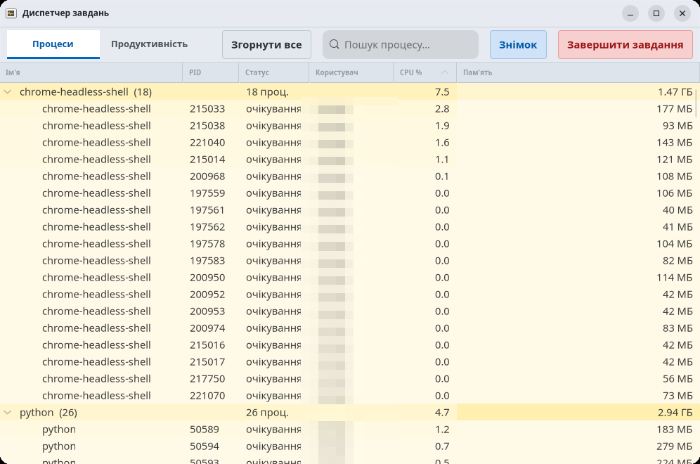

# Диспетчер завдань для Linux (у стилі Windows Task Manager)

Простий, але функціональний монітор системи для Linux, написаний на
**Python 3 + GTK4 + libadwaita + psutil**. Виглядає й поводиться подібно до
Windows Task Manager: процеси згруповані за назвою, з підсвічуванням
навантаження, а вкладка «Продуктивність» показує графіки CPU, пам'яті, диска,
мережі та GPU.



---

## Як запустити

У репозиторії вже є **готові збірки** — виберіть один зі способів:

| Файл | Клік | Процеси видно |
|---|---|---|
| `SystemMonitor-x86_64.AppImage` | подвійний клік | ✅ |
| `system-monitor_1.0.0_all.deb` | подвійний клік → Install | ✅ |
| `SystemMonitor.flatpak` | подвійний клік | ❌ (пісочниця) |

### Варіант 1 — AppImage (портативно, без встановлення)

```bash
chmod +x SystemMonitor-x86_64.AppImage
./SystemMonitor-x86_64.AppImage
```

Після разового дозволу на виконання — просто **двічі клікнути** по файлу.
Потрібні системні GTK4 + libadwaita + Python (на Ubuntu/GNOME вже є).
Якщо не стартує через FUSE — `./SystemMonitor-x86_64.AppImage --appimage-extract-and-run`.

### Варіант 2 — `.deb` (встановлення в систему, Ubuntu/Debian)

```bash
sudo apt install ./system-monitor_1.0.0_all.deb
```

Або **двічі клікнути** по `.deb` → «App Center» → «Встановити».
Після цього з'явиться ярлик **«Диспетчер завдань»** у меню та команда `system-monitor`.

### Варіант 3 — Flatpak

```bash
flatpak install --user ./SystemMonitor.flatpak
flatpak run org.example.SystemMonitor
```

Або **двічі клікнути** по `.flatpak` (якщо в системі встановлено `flatpak`).

> ⚠️ **Обмеження:** у пісочниці Flatpak вкладка «Процеси» **не показує системні
> процеси** (і диск `/` показує корінь пісочниці). Це навмисна ізоляція Linux —
> саме тому жоден системний монітор не постачається як Flatpak. Для повного
> функціоналу використовуйте **AppImage** або **`.deb`**.

### Варіант 4 — прямо з коду

```bash
sudo apt install -y python3-gi python3-psutil python3-gi-cairo \
    gir1.2-gtk-4.0 gir1.2-adw-1 gir1.2-graphene-1.0   # за потреби
python3 system_monitor.py
```

### Параметри командного рядка

```bash
python3 system_monitor.py --expand            # одразу розгорнути групи
python3 system_monitor.py --tab perf:gpu      # відкрити на GPU (cpu|mem|disk|net|gpu)
python3 system_monitor.py --snapshot out.png  # зберегти знімок вікна і вийти
```

---

## Навіщо це

У Linux немає єдиного «Диспетчера завдань» зі звичним виглядом. Цей застосунок
дає:

- звичний інтерфейс (вкладки, таблиця, теплове підсвічування, як у Windows);
- перегляд навантаження в реальному часі;
- окремі графіки на кожне ядро CPU;
- моніторинг дисків, мережі, GPU й температури.

---

## Можливості

### Вкладка «Процеси»
- Процеси **згруповані за назвою**, як у Windows: рядок-група `ім'я (кількість)`
  із **сумарними** CPU/пам'яттю.
- Розгортання/згортання групи (трикутник або подвійний клік), кнопка
  **«Розгорнути все / Згорнути все»**.
- **Теплове підсвічування** рядків за навантаженням CPU (біле → жовте → червоне),
  окреме підсвічування колонки пам'яті.
- Пам'ять у форматі як у Windows: `286 МБ` або `0.37 ГБ`.
- Пошук, сортування за будь-якою колонкою.
- Завершення процесу **з підтвердженням**; завершення всієї групи — гасить усі її
  процеси (SIGTERM).

### Вкладка «Продуктивність»
Лівий список компонентів + права панель із великим графіком і статистикою:
- **Процесор** — сумарний графік + міні-графіки й відсоток **кожного ядра**,
  швидкість (МГц), кількість процесів/потоків, час роботи, температура.
- **Пам'ять** — використання, кеш, підкачка, температура (якщо є датчик).
- **Диск** — швидкість читання/запису, носій, файлова система, ємність/зайнято/вільно,
  температура (NVMe).
- **Езернет** — швидкість і підсумковий обсяг переданих даних, швидкість з'єднання.
- **Графічний процесор (GPU)** — використання, пам'ять, температура (через `nvidia-smi`).

Усі графіки мають **осі**: значення по вертикалі (`%` або `МБ/с`, авто-масштаб)
і позначки часу внизу (`60с … 0`).

### Інше
- Кнопка **«Знімок»** — зберігає вікно у `~/Pictures/system-monitor-<час>.png`.
- **Температури**: CPU (`k10temp`/`coretemp`/`zenpower`), диск (NVMe); RAM — якщо
  в системі є відповідний датчик, інакше `н/д`.

---

## Збірка

### Самодостатній один файл `.pyz` (zipapp)

```bash
mkdir -p build && cp system_monitor.py build/__main__.py
python3 -m zipapp build -o "Диспетчер-завдань.pyz" -p "/usr/bin/env python3"
chmod +x "Диспетчер-завдань.pyz"
```

### `.deb` пакет

Структура:

```
system-monitor/
├── DEBIAN/control
└── usr/
    ├── bin/system-monitor                 # сам застосунок (.pyz)
    └── share/applications/system-monitor.desktop
```

`DEBIAN/control`:

```
Package: system-monitor
Version: 1.0.0
Section: utils
Priority: optional
Architecture: all
Depends: python3, python3-gi, gir1.2-gtk-4.0, gir1.2-adw-1, python3-psutil, python3-gi-cairo
Maintainer: Your Name <you@example.com>
Description: Task manager for Linux (Windows Task Manager style)
```

Збірка:

```bash
dpkg-deb --build --root-owner-group system-monitor system-monitor_1.0.0_all.deb
```

### AppImage

Структура `AppDir/`: `AppRun`, `system-monitor.desktop`, `system-monitor.png`,
`.DirIcon -> system-monitor.png` та `usr/bin/system-monitor` (це `.pyz`).
`psutil` вкладається в `usr/lib/pkgs` (pip-wheel manylinux, abi3).

```bash
ARCH=x86_64 appimagetool AppDir SystemMonitor-x86_64.AppImage
```

### Flatpak

```bash
flatpak install --user flathub org.gnome.Sdk//51 org.gnome.Platform//51
flatpak-builder --user --install --install-deps-from=flathub \
    --disable-rofiles-fuse --repo=repo builddir org.example.SystemMonitor.yml
flatpak build-bundle repo SystemMonitor.flatpak org.example.SystemMonitor
```

Маніфест `org.example.SystemMonitor.yml` бере `system_monitor.py` із репозиторію,
тягне `psutil` за URL і запускає застосунок скриптом `flatpak/system-monitor`.

---

## Примітки

- **GPU** працює лише за наявності NVIDIA (`nvidia-smi`). Для AMD/Intel потрібен
  інший бекенд (`/sys/class/drm/card*/device/gpu_busy_percent`).
- **Температура RAM** зазвичай недоступна — на десктопних DDR-модулях датчика
  часто немає.
- Лічильники мережі/диска ведуться ядром і **скидаються при перезавантаженні**
  (тому «від старту системи»).
- Запуск подвійним кліком на GNOME для скриптів вимкнено з міркувань безпеки —
  користуйтесь готовими збірками вище.

---

## Структура проєкту

```
linux_system_monitor/
├── system_monitor.py              # весь застосунок (один файл)
├── system-monitor.desktop         # ярлик для меню програм
├── SystemMonitor-x86_64.AppImage  # готова портативна збірка
├── system-monitor_1.0.0_all.deb   # готова збірка для Ubuntu/Debian
├── SystemMonitor.flatpak          # готова Flatpak-збірка
├── org.example.SystemMonitor.yml  # маніфест Flatpak
├── flatpak/
│   └── system-monitor             # запускний скрипт для Flatpak
├── screenshot.png                 # знімок вікна
├── README.md
└── .gitignore
```
